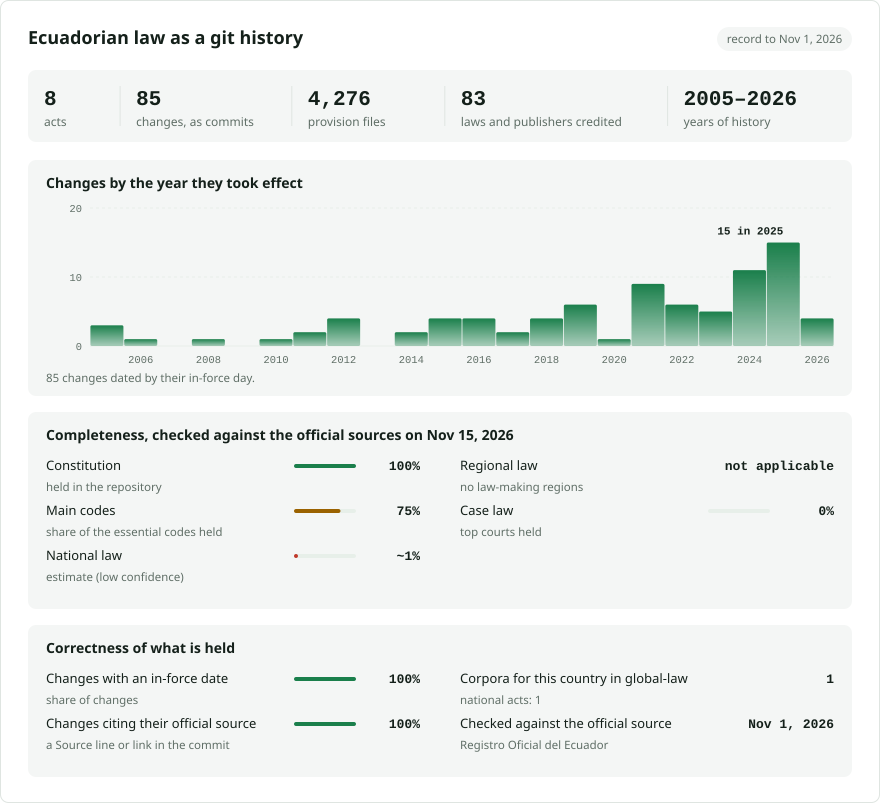

# Ecuador: law history in git

[Español](README.md) · **English**

<picture>
<source media="(prefers-color-scheme: dark)" srcset="data/effort-dark.svg">

</picture>

The law of Ecuador as a git history: one file per provision, one commit per version on the day it took effect, and the law, ruling or referendum that made each change as the commit's author. `git blame` names the act behind every paragraph; `git log` lists every change to an article; picking a date gives the text in force that day.

Part of [lexifina/global-law](https://github.com/lexifina/global-law), one git history for every country's law: this is Ecuador's national law, which global-law reads at `ecuador/national/acts/`.

**What is in it now:** the Constitution of 2008 and 7 other acts (the Código Civil, the Código Orgánico Integral Penal and five organic laws of 2023 to 2025), with 92 versions from 2005 to 2026. Each act's own `README.md` (for example [`constitucion/README.md`](constitucion/README.md)) lists its provisions and how often each changed; [`data/laws.csv`](data/laws.csv) lists every law, ruling and referendum in the record.

Each act is a folder with one file per article or provision: `constitucion/`, `codigo-civil/`, `coip/`, `lotaip/`, `ley-transformacion-digital/`, `ley-personas-discapacidad/`, `ley-competencia-desleal/` and `ley-inteligencia/` (`constitucion/art-114.md` is Article 114 of the Constitution, on re-election); each folder's `titulos.md` holds the headings of its titles and chapters.

The text is in Spanish, as the Registro Oficial printed it, misprints included. An English translation is not part of this record.

## Questions as git commands

| Question | Command |
| --- | --- |
| Every change to Article 114 of the Constitution | `git log -p --word-diff -- constitucion/art-114.md` |
| Which act wrote each line of Article 114? | `git blame constitucion/art-114.md` |
| Every version of Article 114, with the day each took effect | `git log --format="%h %(trailers:key=In-force,valueonly,separator=) %an" -- constitucion/art-114.md` |
| Article 114 as in force on 1 January 2018 | `python tools/vigente_el.py 2018-01-01 constitucion 114` |

**Outside git**, we also host this record publicly, for free:

- **[Ask Claude about Ecuadorian law](https://global-law.lexifina.com/v1/try_claude?country=ecuador)**: opens Claude with a first question ready.
- **[Ask ChatGPT](https://global-law.lexifina.com/v1/try_chatgpt?country=ecuador)**: the same question in ChatGPT.
- **[Search Ecuadorian law on our site](https://lexifina.com/law?country=ecuador&q=arrendamiento)**: a search for "arrendamiento" (lease), with each provision's text and its versions, no account needed.
- **[Developer REST API](https://global-law.lexifina.com/v1/search_law?query=arrendamiento&jurisdiction=ecuador)**: the same search as JSON, with no key. See the [documentation here](https://lexifina.com/api/global-law).

Both assistants read the record through the free Global law connector (MCP, `https://global-law.lexifina.com/mcp`); the first time, the chat gives you the link that adds it. Ask in Spanish or in English.

**Host it yourself easily.** All it takes is git and Python, and the tools run on your machine:

```sh
git clone --depth 1 https://github.com/lexifina/global-law && cd global-law
python3 tools/countries.py add ecuador/national/acts
python3 tools/law.py show 2026-01-01 ecuador/national/acts/constitucion/art-114.md
```

Opened in Claude Code, Cursor, VS Code or Codex, the clone also starts a local MCP server with the same tools ([MCP.md](https://github.com/lexifina/global-law/blob/main/MCP.md)).

## Dates

Each commit is dated at noon, America/Guayaquil, on the day the version took effect, and carries it in its `In-force:` trailer (with `Enacted:` and `Published:`):

- a law is in force from its promulgation in the Registro Oficial unless it sets another day (Código Civil art. 6); the COIP, for example, took effect 180 days after publication, on 10 August 2014;
- a referendum takes effect when the Consejo Nacional Electoral's results are published in the Registro Oficial; a rejected one changes no words and is a commit on the day of the vote;
- a Constitutional Court ruling is dated on its publication, except Sentencia 018-18-SIN-CC, dated on its notification (2 August 2018), as the Court's own auto explains.

Each change is credited to the law, ruling or referendum that made it, with an address that cannot exist (`referendo-2018@registroficial.invalid`); the committer is Lexifina. The Código Civil starts from its 2005 codification, the oldest text available, credited to the Registro Oficial.

## How it is checked

- No official consolidated text exists: the Registro Oficial publishes gazette editions only. Each act starts from its text as published there, and each later version replays one act, ruling or referendum from the text layer of its own edition, applying exactly the edits it states; every inserted phrase must occur word for word in that edition.
- `tools/check_repo.py` reads every version back from git on the day it took effect and on the day before, and compares it with the corpus: 92 versions, 0 mismatches (see [`REPRODUCE.md`](REPRODUCE.md)).
- The text was compared, for reading only, with editorial consolidations (no text copied): the Constitution agrees in 430 of 444 articles on 25 January 2021, the Código Civil's current text in 2,362 of 2,428, and the COIP in 663 of 754 on 13 October 2021; `REPRODUCE.md` explains the differences.
- Health checks: no merge commits, commit dates never go backwards, nothing is dated in the future, and every commit's trailers parse.

## What it does not show

- **Reforms printed only as page images.** This repository does not OCR them, so their words are missing and the articles they changed keep wording that is no longer the law: the Constitution's art. 272 from 25 January 2021 and art. 138 from 30 May 2024, and the articles named by 7 acts and rulings for the Código Civil and 22 for the COIP (each of these a commit marked "NOT APPLIED" on its day).
- **Reforms that could not be read.** Many laws since 2021 are page images, so whether they amend these acts is not always known.
- **Most of Ecuador's law.** Eight acts are here. The Código de Comercio, the COGEP and the Código del Trabajo are built on the `preview` branch only and are not the law in force; the data protection law of 2021 is printed only as page images.
- **Court rulings that interpret** a text without striking words are not commits.
- **The Kichwa and Shuar versions** of the Constitution.

## Sources

| Source | Kind | Past versions | Notes |
| --- | --- | --- | --- |
| [Registro Oficial](https://www.registroficial.gob.ec) | Official gazette (run by the Corte Constitucional) | gazette editions only | Every word of law here, cut from each edition's PDF text layer, rulings included |
| [Asamblea Nacional](https://www.asambleanacional.gob.ec/es/leyes-aprobadas) | List of the laws it passed | n/a | The laws on its list were searched, in their gazette text, for amendments to the acts here |
| Lexis, Ediciones Legales, Andina Ediciones | Editorial consolidations | yes | Read only as indexes and for comparison; no text copied |

## Licence

See [`LICENSE`](LICENSE). The Registro Oficial states no licence for its editions; they are official legal texts of the Republic of Ecuador, which are public. Lexifina's own contributions (the arrangement of the history, the commit messages, the tables and the tools) are dedicated to the public domain under CC0 1.0.

No AI model wrote, translated or corrected legal text, and no OCR output is legal text; the scripts, and the map of which provision each act changes, were written by an AI model (see [`REPRODUCE.md`](REPRODUCE.md)).

## More

From [lexifina/global-law](https://github.com/lexifina/global-law):

- [FEATURES.md](https://github.com/lexifina/global-law/blob/main/FEATURES.md): every feature, and what every corpus must support (`git blame`, `law.py`, the MCP tools)
- [FAQ.md](https://github.com/lexifina/global-law/blob/main/FAQ.md): questions and answers · [CONTRIBUTING.md](https://github.com/lexifina/global-law/blob/main/CONTRIBUTING.md): proposing changes · [MCP.md](https://github.com/lexifina/global-law/blob/main/MCP.md): the MCP server · [REPRODUCE.md](https://github.com/lexifina/global-law/blob/main/REPRODUCE.md): how it was built · [CHANGELOG.md](https://github.com/lexifina/global-law/blob/main/CHANGELOG.md)
- [FRESHNESS.md](https://github.com/lexifina/global-law/blob/main/FRESHNESS.md): how current each corpus is · [Monitoring](https://github.com/lexifina/global-law/tree/main/monitoring): whether updates are running · [WATCHING.md](https://github.com/lexifina/global-law/blob/main/WATCHING.md): how each official source is watched for changes
- [performance/](https://github.com/lexifina/global-law/tree/main/performance): how fast the tools are, measured
- [visualisations/](https://github.com/lexifina/global-law/tree/main/visualisations): charts and bridges across the world's law
- [Vulnerabilities](https://github.com/lexifina/global-law/tree/main/vulnerabilities): mistakes in legislation as published
