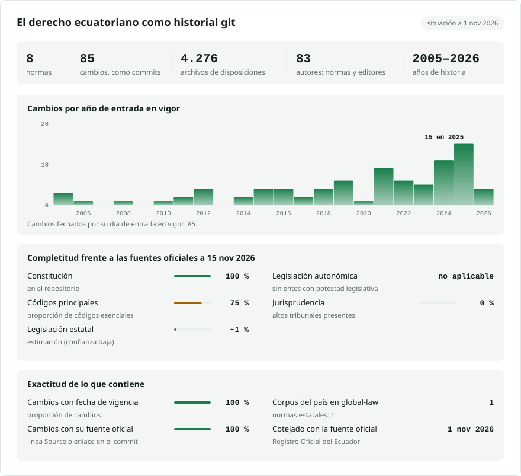

# Ecuador: historia del derecho en git

**Español** · [English](README.en.md)

<picture>
<source media="(prefers-color-scheme: dark)" srcset="data/es/effort-dark.svg">

</picture>

El derecho del Ecuador como historia de git: un archivo por disposición, un commit por versión el día en que entró en vigencia, y la ley, la sentencia o el referéndum que hizo cada cambio como autor del commit. `git blame` indica la norma que está detrás de cada párrafo; `git log` enumera todos los cambios de un artículo; al elegir una fecha se obtiene el texto vigente ese día.

Forma parte de [lexifina/global-law](https://github.com/lexifina/global-law), una única historia de git para el derecho de todos los países: este es el derecho nacional del Ecuador, que global-law lee en `ecuador/national/acts/`.

**Qué contiene ahora:** la Constitución de 2008 y otras 7 normas (el Código Civil, el Código Orgánico Integral Penal y cinco leyes orgánicas de 2023 a 2025), con 92 versiones desde 2005 hasta 2026. El `README.md` propio de cada norma (por ejemplo, [`constitucion/README.md`](constitucion/README.md)) enumera sus disposiciones y cuántas veces cambió cada una; [`data/laws.csv`](data/laws.csv) enumera todas las leyes, sentencias y referéndums del registro.

Cada norma es una carpeta con un archivo por artículo o disposición: `constitucion/`, `codigo-civil/`, `coip/`, `lotaip/`, `ley-transformacion-digital/`, `ley-personas-discapacidad/`, `ley-competencia-desleal/` y `ley-inteligencia/` (`constitucion/art-114.md` es el Artículo 114 de la Constitución, sobre la reelección); el `titulos.md` de cada carpeta contiene los encabezados de sus títulos y capítulos.

El texto está en español, tal como lo publicó el Registro Oficial, erratas incluidas. Este registro no incluye una traducción al inglés.

## Preguntas como comandos de git

| Pregunta | Comando |
| --- | --- |
| Todos los cambios del Artículo 114 de la Constitución | `git log -p --word-diff -- constitucion/art-114.md` |
| ¿Qué norma escribió cada línea del Artículo 114? | `git blame constitucion/art-114.md` |
| Todas las versiones del Artículo 114, con el día en que entró en vigencia cada una | `git log --format="%h %(trailers:key=In-force,valueonly,separator=) %an" -- constitucion/art-114.md` |
| El Artículo 114 vigente al 1 de enero de 2018 | `python tools/vigente_el.py 2018-01-01 constitucion 114` |

**Fuera de git**, también alojamos este registro de forma pública y gratuita:

- **[Preguntar a Claude sobre el derecho ecuatoriano](https://global-law.lexifina.com/v1/try_claude?country=ecuador)**: abre Claude con una primera pregunta preparada.
- **[Preguntar a ChatGPT](https://global-law.lexifina.com/v1/try_chatgpt?country=ecuador)**: la misma pregunta en ChatGPT.
- **[Buscar en el derecho ecuatoriano en nuestro sitio](https://lexifina.com/law?country=ecuador&q=arrendamiento)**: una búsqueda de "arrendamiento", con el texto de cada disposición y sus versiones, sin necesidad de cuenta.
- **[API REST para desarrolladores](https://global-law.lexifina.com/v1/search_law?query=arrendamiento&jurisdiction=ecuador)**: la misma búsqueda en JSON, sin clave. Consulte la [documentación aquí](https://lexifina.com/api/global-law).

Ambos asistentes leen el registro a través del conector gratuito Global law (MCP, `https://global-law.lexifina.com/mcp`); la primera vez, el chat le da el enlace para agregarlo. Pregunte en español o en inglés.

**Alójelo usted mismo fácilmente.** Solo hacen falta git y Python, y las herramientas se ejecutan en su equipo:

```sh
git clone --depth 1 https://github.com/lexifina/global-law && cd global-law
python3 tools/countries.py add ecuador/national/acts
python3 tools/law.py show 2026-01-01 ecuador/national/acts/constitucion/art-114.md
```

Abierto en Claude Code, Cursor, VS Code o Codex, el clon también inicia un servidor MCP local con las mismas herramientas ([MCP.md](https://github.com/lexifina/global-law/blob/main/MCP.md)).

## Fechas

Cada commit está fechado a las doce del mediodía, hora de America/Guayaquil, del día en que la versión entró en vigencia, y lleva ese día en su trailer `In-force:` (con `Enacted:` y `Published:`):

- una ley rige desde su promulgación en el Registro Oficial, salvo que establezca otro día (art. 6 del Código Civil); el COIP, por ejemplo, entró en vigencia 180 días después de su publicación, el 10 de agosto de 2014;
- un referéndum surte efecto cuando los resultados del Consejo Nacional Electoral se publican en el Registro Oficial; uno rechazado no cambia ninguna palabra y es un commit el día de la votación;
- una sentencia de la Corte Constitucional se fecha por su publicación, salvo la Sentencia 018-18-SIN-CC, fechada por su notificación (2 de agosto de 2018), como explica el propio auto de la Corte.

Cada cambio se atribuye a la ley, la sentencia o el referéndum que lo hizo, con una dirección que no puede existir (`referendo-2018@registroficial.invalid`); el committer es Lexifina. El Código Civil parte de su codificación de 2005, el texto más antiguo disponible, atribuido al Registro Oficial.

## Cómo se verifica

- No existe ningún texto consolidado oficial: el Registro Oficial solo publica ediciones. Cada norma parte de su texto tal como se publicó allí, y cada versión posterior reproduce una ley, una sentencia o un referéndum a partir de la capa de texto de su propia edición, aplicando exactamente las modificaciones que esa norma dispone; cada frase insertada debe aparecer palabra por palabra en esa edición.
- `tools/check_repo.py` vuelve a leer desde git cada versión el día en que entró en vigencia y el día anterior, y la compara con el corpus: 92 versiones, 0 discrepancias (véase [`REPRODUCE.md`](REPRODUCE.md)).
- El texto se cotejó, solo como lectura, con textos consolidados de editoriales (sin copiar ningún texto): la Constitución coincide en 430 de 444 artículos al 25 de enero de 2021, el texto actual del Código Civil en 2.362 de 2.428, y el COIP en 663 de 754 al 13 de octubre de 2021; `REPRODUCE.md` explica las diferencias.
- Comprobaciones de integridad: no hay commits de fusión (merge), las fechas de los commits nunca retroceden, nada está fechado en el futuro y los trailers de todos los commits se analizan sin errores.

## Qué no muestra

- **Las reformas publicadas solo como imágenes de página.** Este repositorio no les aplica OCR, por lo que sus palabras faltan y los artículos que modificaron conservan una redacción que ya no es la vigente: el art. 272 de la Constitución desde el 25 de enero de 2021 y el art. 138 desde el 30 de mayo de 2024, y los artículos señalados por 7 normas y sentencias en el caso del Código Civil y por 22 en el del COIP (cada una de ellas, un commit marcado "NOT APPLIED" en su día).
- **Las reformas que no pudieron leerse.** Muchas leyes desde 2021 son imágenes de página, por lo que no siempre se sabe si modifican estas normas.
- **La mayor parte del derecho del Ecuador.** Aquí hay ocho normas. El Código de Comercio, el COGEP y el Código del Trabajo se compilan solo en la rama `preview` y no son el derecho vigente; la ley de protección de datos de 2021 solo está publicada como imágenes de página.
- **Las sentencias que interpretan** un texto sin suprimir palabras no son commits.
- **Las versiones en kichwa y shuar** de la Constitución.

## Fuentes

| Fuente | Tipo | Versiones anteriores | Notas |
| --- | --- | --- | --- |
| [Registro Oficial](https://www.registroficial.gob.ec) | Diario oficial (a cargo de la Corte Constitucional) | solo ediciones | Cada palabra de las normas que hay aquí, extraída de la capa de texto del PDF de cada edición, sentencias incluidas |
| [Asamblea Nacional](https://www.asambleanacional.gob.ec/es/leyes-aprobadas) | Lista de las leyes que aprobó | no corresponde | En las leyes de su lista se buscaron, en su texto del Registro Oficial, reformas a las normas que hay aquí |
| Lexis, Ediciones Legales, Andina Ediciones | Textos consolidados de editoriales | sí | Leídas solo como índices y para comparar; no se copió ningún texto |

## Licencia

Véase [`LICENSE`](LICENSE). El Registro Oficial no indica ninguna licencia para sus ediciones; son textos jurídicos oficiales de la República del Ecuador, que son públicos. Las contribuciones propias de Lexifina (la organización de la historia, los mensajes de commit, las tablas y las herramientas) se dedican al dominio público conforme a CC0 1.0.

Ningún modelo de IA escribió, tradujo ni corrigió texto normativo, y ningún resultado de OCR es texto normativo; los scripts, y el mapa de qué disposición modifica cada norma, los escribió un modelo de IA (véase [`REPRODUCE.md`](REPRODUCE.md)).

Esta es una traducción de la versión inglesa ([README.en.md](README.en.md)); si difieren, prevalece la versión inglesa.

## Más información

Del repositorio [lexifina/global-law](https://github.com/lexifina/global-law) (páginas en inglés):

- [FEATURES.md](https://github.com/lexifina/global-law/blob/main/FEATURES.md): todas las funciones y lo que cada corpus debe admitir (`git blame`, `law.py`, herramientas MCP)
- [FAQ.md](https://github.com/lexifina/global-law/blob/main/FAQ.md): preguntas y respuestas · [CONTRIBUTING.md](https://github.com/lexifina/global-law/blob/main/CONTRIBUTING.md): proponer cambios · [MCP.md](https://github.com/lexifina/global-law/blob/main/MCP.md): servidor MCP · [REPRODUCE.md](https://github.com/lexifina/global-law/blob/main/REPRODUCE.md): cómo se ha construido · [CHANGELOG.md](https://github.com/lexifina/global-law/blob/main/CHANGELOG.md)
- [FRESHNESS.md](https://github.com/lexifina/global-law/blob/main/FRESHNESS.md): lo actualizado que está cada corpus · [Supervisión](https://github.com/lexifina/global-law/tree/main/monitoring): si las actualizaciones funcionan · [WATCHING.md](https://github.com/lexifina/global-law/blob/main/WATCHING.md): cómo se vigila cada fuente oficial para detectar cambios
- [performance/](https://github.com/lexifina/global-law/tree/main/performance): la rapidez de las herramientas, medida
- [visualisations/](https://github.com/lexifina/global-law/tree/main/visualisations): gráficos y conexiones a través del derecho de todo el mundo
- [Vulnerabilidades](https://github.com/lexifina/global-law/tree/main/vulnerabilities): errores en las normas tal como se publicaron
